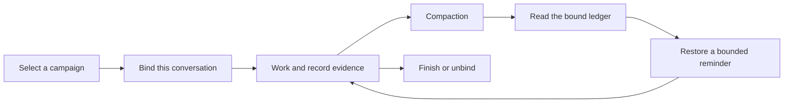

# Campaign Manager

**Durable task continuity for Hermes and Codex, with a read-only web dashboard.**

Keep a long implementation or research campaign connected to its objective after compaction, interruptions and new sessions. Campaign Manager stores a local work ledger, binds a conversation to one selected campaign, and restores a short reminder from that campaign when work continues.

[Install](docs/install.md) · [Dependencies](docs/dependencies.md) · [Codex setup](docs/install-codex.md) · [Hermes setup](docs/install-hermes.md) · [Dashboard](docs/dashboard.md) · [Use a campaign](docs/usage.md)

## For agent

Read and follow the [agent installation instructions](docs/install-agent.md).

## Why install it?

A long task can survive on disk while disappearing from the agent's working context. A progress file helps only when the agent finds it, reads it and recognizes which parts still apply. A memory search can recover useful background, but relevance alone does not identify the active assignment.

Campaign Manager makes that assignment explicit. You select a campaign and bind the conversation to it. The ledger holds its objective, scope, outstanding work and reviewed evidence. After compaction, the adapter reads that exact campaign and brings a bounded reminder into the next continuation. Unbinding stops that conversation's reminders.

This is useful for work that spans many tool calls or sessions: a repository migration, a data pipeline, a literature review, or a research deliverable with several workstreams. Ordinary short tasks do not need a campaign.

## What happens during a campaign



| Mechanism | What it does |
| --- | --- |
| Explicit bind / unbind | Selects which campaign belongs to the conversation. No campaign is guessed from a folder or another chat. |
| Local SQLite ledger | Preserves campaign identity, work packages, evidence receipts and reviewed outcomes. |
| Continuation hooks | Restore current bound state after compaction and refresh it during continuation. |
| Reminder cap | Keeps each reminder within 2,000 characters. |
| Version checks | Reject stale writes so concurrent agents must read current state before retrying. |
| Parent reconciliation | Requires a review step before a completed package can be accepted. |

Refreshing a reminder is a read. It does not create a new checkpoint record, mark a package complete or advance the campaign. The agent deliberately records progress through the tools.

## Choose your client

Both adapters use the included core. They can share a ledger on the same host when configured with the same state directory; their conversation bindings remain separate.

| | Codex | Hermes |
| --- | --- | --- |
| Installation | Local plugin marketplace | Native standalone plugin and a local MCP router |
| Binding identity | Native thread metadata | Runtime conversation identity and authenticated router channels |
| After compaction | Native hook context | Request middleware on the next eligible model request |
| During tool continuation | Separate model context after the tool | Advisory appended to the existing completed tool result |
| Model request support | Native local Codex hook runtime | Chat Completions projection |

See [compatibility and verification](docs/compatibility.md) for tested versions and limits. Hermes's Anthropic Messages and Codex Responses request modes currently receive no reminder. Its tools remain usable independently of the reminder projection.

## Dependencies

The research and engineering profiles rely on two skill libraries maintained by other people. Campaign Manager doesn't bundle or modify them. Install them from their own repositories:

- [Superpowers](https://github.com/obra/superpowers) by Jesse Vincent (MIT): execution, review and verification discipline. Needed by `engineering` and `research_delivery`.
- [Co-Researcher](https://github.com/poemswe/co-researcher) by poemswe (MIT): research method and academic-integrity skills. Needed by `research` and `research_delivery`.

`research_delivery` is the default profile, so a default campaign expects both. `status_only` needs neither. [Dependencies](docs/dependencies.md) gives the tested releases and the install commands for Hermes and Codex; [`dependencies.json`](dependencies.json) is the machine-readable copy.

## Install

Requirements: Node.js 24 or newer. The core and dashboard use Node built-ins with no npm runtime dependencies. Hermes also needs its own Python runtime and plugin APIs. The target platforms are native Windows, Linux and macOS; see the [verification boundaries](docs/compatibility.md).

Download the npm archive from the release, then install the command:

```bash
npm install --global --ignore-scripts ./agent-campaign-manager-0.2.0.tgz
campaign-manager --help
campaign-manager init
```

These commands work in PowerShell and POSIX shells. The package does not need an npm registry listing: npm can install the release archive directly. This source preparation does not publish a registry package or a hosted download URL. [Shell and PowerShell installers](docs/install.md) use the same archive.

`init` explicitly creates an empty ledger. It creates no sample campaigns and retains existing compatible campaigns. `omo-research` preserves the inherited schema convention. An incompatible database stops setup. Use `--state-dir` to select another absolute directory consistently for every command.

Then follow the client guide:

- **[Codex installation](docs/install-codex.md):** run `campaign-manager prepare codex`, add the generated local marketplace, and review the hooks.
- **[Hermes installation](docs/install-hermes.md):** run `campaign-manager prepare hermes`, review its configuration fragment, and enable it in the selected profile.

Preparation generates standalone installation files outside the npm package. Hook trust and client activation are explicit. Existing output directories are preserved; choose a new `--output` for an update.

## Inspect campaigns in a browser

```bash
campaign-manager dashboard
```

Open the printed loopback address. The dashboard reads the same ledger as the adapters and shows campaigns, work packages, gates, decisions and recent activity. Stored campaign status is separate from current agent activity. It cannot create or change a campaign.

Use `--projects projects.json` to group nested repositories under parent projects. No personal repository list is bundled. See [dashboard configuration](docs/dashboard.md) for the catalog format, shared state selection and network boundary.

## A first campaign

After installation, give the agent a bounded objective and explicitly approve creating a campaign:

> Create an engineering campaign named `parser-migration` for migrating this repository's parser. Keep its objective and acceptance criteria in the ledger. Bind this conversation to it, divide the work into bounded packages, and record evidence before accepting a package. After compaction, continue from the bound campaign. Ask before widening the scope.

On a later session:

> Find `parser-migration`, inspect its objective and scope, then bind this conversation to it. Read current status and preflight before continuing the outstanding work.

A fresh process starts unbound. Sharing a database does not silently resume a campaign. See [usage](docs/usage.md) for tools, switching campaigns, errors and finish rules.

## Research and engineering skills

The campaign layer works with profile-specific skill guidance:

| Profile | Expected method / execution layer |
| --- | --- |
| `research` | Co-Researcher |
| `engineering` | Superpowers |
| `research_delivery` (default) | Both |
| `status_only` | Neither |

Install [Co-Researcher](https://github.com/poemswe/co-researcher) and [Superpowers](https://github.com/obra/superpowers) from upstream as described in [dependencies](docs/dependencies.md). The profiles declare expectations; the agent must load and follow the applicable skills. The ledger does not prove that the agent used a research method correctly or reviewed evidence thoroughly. Select the profile that matches the work rather than applying research requirements to every task.

## Boundaries

Campaign Manager helps recover the active objective and unfinished work. It cannot guarantee model obedience, correct research, automatic follow-through or freedom from loops. Stored campaign text is advisory; current owner instructions still control steering, cancellation and scope.

State stays local to the configured directory. The plugin has no hosted backend or telemetry service. Reminder text becomes part of the model context and therefore goes to the provider already selected in your client. Keep sensitive material out of a campaign unless that provider is appropriate for it. Local processes running as the same OS user are outside the conversation-isolation boundary.

## Development

Use the source archive or a checkout for development and verification. Runtime installation does not require these test tools.

```bash
npm test
npm run validate
python -m pytest hermes/tests -q
```

Python tests require `pytest` in your development environment. Native Hermes integration tests are optional and need the host checkout/runtime described in [contributing](CONTRIBUTING.md). The OMO interoperability test is optional and needs its external adapter; a skip does not certify that client.

The release includes MIT-licensed source. [License](LICENSE) · [Third-party notices](THIRD_PARTY_NOTICES.md) · [Source provenance](docs/provenance.md)
